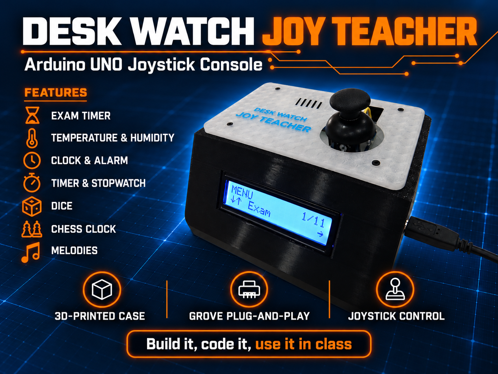
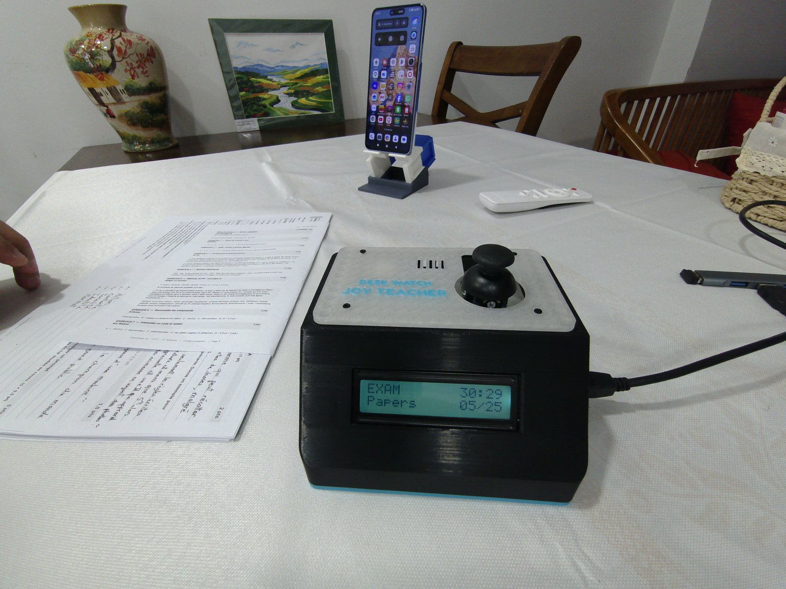
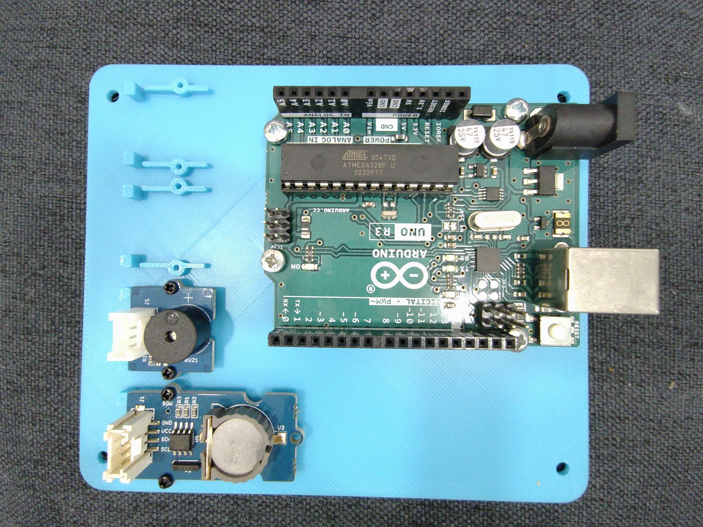
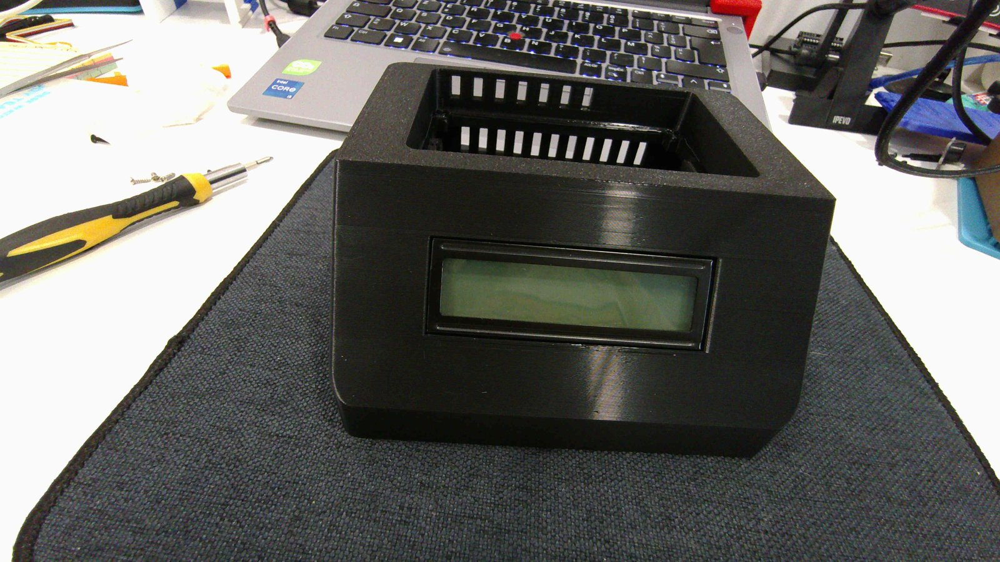
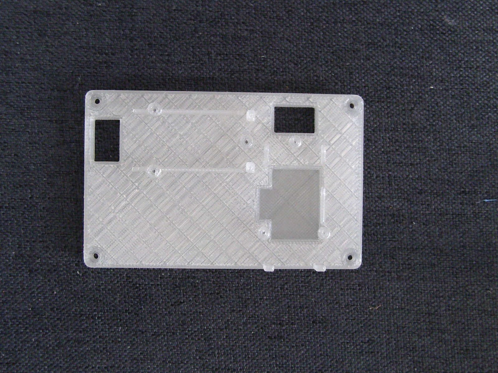
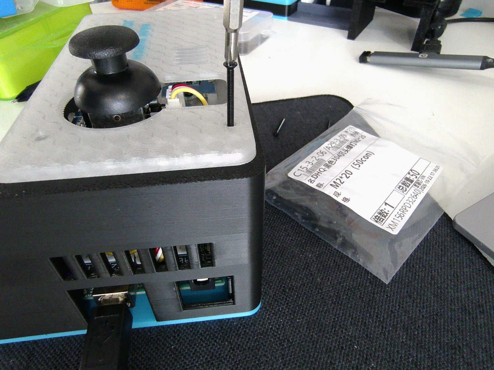
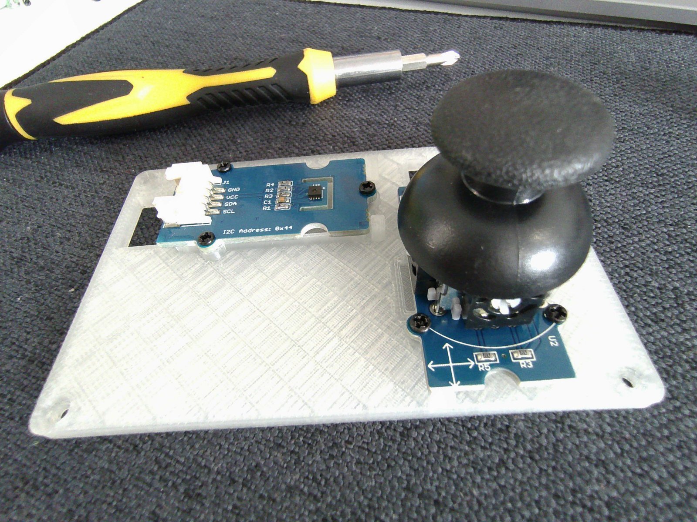

# Desk Watch: JOY TEACHER EDITION

An Arduino UNO desk console for teachers: an **exam countdown with a paper counter**, plus temperature and humidity, timers, a stopwatch, an alarm, dice, a chess clock and melodies. It is controlled with a single thumb joystick, built from Grove modules (no soldering), and housed in a 3D-printed case.

## Features

- **Exam**: set the duration (1 to 240 min) and the expected number of papers (1 to 99). Each push of the joystick counts one collected paper. Two beeps at the end of the time, a green "all papers in" screen with the real working time (pauses excluded). Pause, +5 min, subtract one paper and end with confirmation.
- **Temp & Hum**: live readings, minimum, maximum and average, with adjustable thresholds, backlight colours and buzzer alerts.
- **Timer** (Pomodoro), **Counter**, **Stopwatch**, **Alarm** (8 ringtones), **Dice** (D2 to D100), **Chess clock** (11 time controls), **Melodies**.
- **Settings**: brightness, volume, startup sound, auto sleep, night mode, set time, favorite start page, factory reset.
- An 11-entry menu. An RTC module provides the clock, the alarm and the automatic night mode.
- Two firmware versions: English and French (one language per sketch).

## Joystick

| Gesture | Effect |
|---|---|
| Up / down | Scroll the menu, change a value (held: repeat, faster after 1.5 s) |
| Right, or click on the head | OK |
| Right (or click) twice within 0.4 s | Double click: page action |
| Left | Back (menu, cancel) |
| Left held 2.5 s | Sleep (any movement wakes the device) |
| Chess clock running: any movement | Switch player; held 1.2 s or click = pause |

Do not touch the joystick when powering the board on: its centre is measured at that moment.

## Hardware

| Part | Connection |
|---|---|
| Arduino UNO R3 + Grove Base Shield | |
| Grove LCD RGB Backlight V4.0 | I2C |
| Grove SHT31 or SHT40 (auto-detected) | I2C, address 0x44 |
| RTC module DS1307 or DS3231 (required) | I2C, address 0x68 |
| Grove Thumb Joystick | X on A1, Y on A2 |
| Grove Buzzer | D3 |

Wiring diagrams: [`docs/wiring_EN.png`](docs/wiring_EN.png) and [`docs/wiring_FR.png`](docs/wiring_FR.png).

Screws: 4 x M3x6 (UNO), 4 x M3x12 countersunk (base on shell), 15 x M1.7x5 (13 for the Grove modules, 2 for the RTC), 4 x M2x20 (cover and tray).

## Software

1. Install the Arduino IDE.
2. Install the library **Grove - LCD RGB Backlight** (Library Manager). The SHT sensor and the RTC are read directly over I2C: no other library is needed.
3. Open `Desk_Watch_JOY_TEACHER_Edition_EN/Desk_Watch_JOY_TEACHER_Edition_EN.ino` (or the `_FR` sketch), select **Arduino Uno**, and upload.

The sketch uses about 94 % of the UNO flash memory: it leaves little room for additions.

## Photos

| Base | Shell | Tray | Cover |
|---|---|---|---|
|  |  |  |  |

The sensor sits behind a ventilation window in the tray, so it reads the room air:

## Documentation

- Assembly guide: [English](docs/EN_Desk_Watch_JOY_TEACHER_Assembly_Guide.pdf) | [Français](docs/FR_Desk_Watch_JOY_TEACHER_Guide_de_montage.pdf)
- User guide: [English](docs/EN_Desk_Watch_JOY_TEACHER_User_Guide.pdf) | [Français](docs/FR_Desk_Watch_JOY_TEACHER_Mode_d_emploi.pdf)

## 3D-printed case

Four parts (base, shell, tray, cover), designed for Bambu Lab printers and printed in PLA, with one colour per part if you like. They are the same parts as the JOY STUDENT edition. The 3D files are published only on MakerWorld: [DIY Desk Watch JOY TEACHER | Arduino UNO Grove](https://makerworld.com/en/models/3508991-diy-desk-watch-joy-teacher-arduino-uno-grove). Suggested print order: base, shell, tray, cover.

## Status

Built and tested on an Arduino UNO R3. Other boards are not tested yet.

## Project pages

- [Hackster.io](https://www.hackster.io/Pr_Belamine_Makerlab/desk-watch-joy-teacher-arduino-uno-exam-console-7a2803): build story, parts list and wiring.
- [MakerWorld](https://makerworld.com/en/models/3508991-diy-desk-watch-joy-teacher-arduino-uno-grove): 3D files and print profiles.

## Related projects

- [Desk Watch](https://github.com/PrBelamine/desk-watch): the original console with a rotary dial and a button.
- [Desk Watch: JOY STUDENT EDITION](https://github.com/PrBelamine/desk-watch-joy-student): the same console for students, without the Exam page.

## License

GNU General Public License v3.0, see [LICENSE](LICENSE).

---

## En français

Console de bureau Arduino UNO pour les enseignants : **compte à rebours d'examen avec comptage des copies**, température et humidité, minuteur, chrono, réveil, dé, pendule d'échecs et mélodies, pilotée par un joystick. Modules Grove (sans soudure), boîtier imprimé en 3D.

- Sketch français : `Desk_Watch_JOY_TEACHER_Edition_FR`. Bibliothèque nécessaire : « Grove - LCD RGB Backlight ». Carte : Arduino Uno.
- Guides : [montage](docs/FR_Desk_Watch_JOY_TEACHER_Guide_de_montage.pdf) et [mode d'emploi](docs/FR_Desk_Watch_JOY_TEACHER_Mode_d_emploi.pdf). Schéma de câblage : [`docs/wiring_FR.png`](docs/wiring_FR.png).
- Testé sur Arduino UNO R3. Les autres cartes ne sont pas testées.
- Réalisé par un enseignant, Pr. BELAMINE MakerLab.
